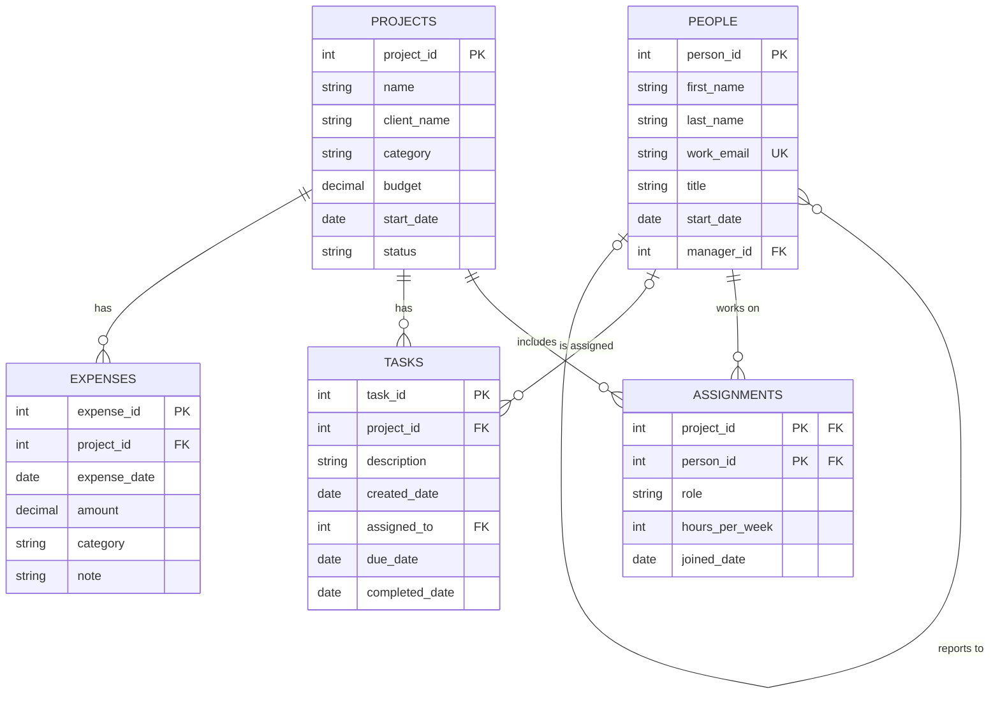

# BabsonAI Labs Database

## 1. The Scenario

**A. BabsonAI Labs.** A 25-person startup that builds AI tools for small businesses. It tracks who works on what, where the money goes, and who is overloaded: its people and who they report to, its projects and their budgets, who works on which project and how many hours a week, the tasks on each project and who they are assigned to, and the expenses charged to each project.

## 2. The ERD

## 3. What One Row Means

- One row of `people` is one employee of BabsonAI Labs, including the two founders.
- One row of `projects` is one project the company is running, for a client or for itself.
- One row of `assignments` is one person's commitment to one project: their role on it, the hours a week they give it, and the date they joined.
- One row of `tasks` is one piece of work on one project, assigned to at most one person.
- One row of `expenses` is one cost charged to one project.

## 4. Design Choices

**The key.** `work_email` looks like a natural key, the way an order number or a ticker would be, but the scenario says it changes whenever somebody changes title. A primary key is not supposed to change, so I gave `people` a surrogate key, `person_id`, instead, and kept `work_email` as `UNIQUE` so no two people can still share one.

**Optional relationships.** `people.manager_id` is nullable because "the two founders report to nobody." `projects.client_name` is nullable because "internal projects have none." `tasks.assigned_to` is nullable because "a new task may be unassigned," and `tasks.completed_date` is nullable because it "stays empty until it is" completed.

**The rule the tables cannot hold.** "A task is assigned only to somebody who works on its project" compares three tables at once — `tasks`, `assignments` and `people` — and a `CHECK` can only look at one row of one table, so the database cannot enforce it. `build.py`'s business question 7 checks it instead, with a query that joins `tasks` to `assignments` and finds any assigned task whose person is not on that project's team.

**Working with the agent.Working with the agent. I collaborated with my agent: I gave it the scenario and asked it to create the ERD and the CREATE TABLE statements. The agent noticed that one rule from the scenario wasn't enforced in make_data.py — that a task can't be created before the person it's assigned to has started — and fixed the data generator so no task breaks that rule. I checked the optional relationships in the data myself, to make sure each one matched a specific sentence in the scenario (no one to report to, no client, unassigned, incomplete) rather than just trusting the nullable option.