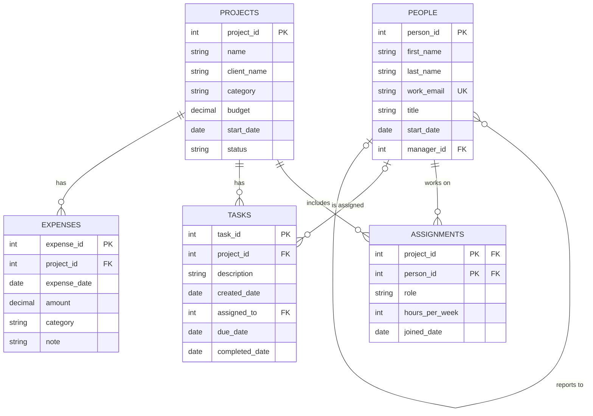

# BabsonAI Labs Database

## 1. The Scenario

**A. BabsonAI Labs.** A 25-person startup that builds AI tools for small businesses. It tracks who works on what, where the money goes, and who is overloaded: its people and who they report to, its projects and their budgets, who works on which project and how many hours a week, the tasks on each project and who they are assigned to, and the expenses charged to each project.

## 2. The ERD

## 3. What One Row Means

*(To do, by hand: one sentence per table, in the way Northwind's would read, e.g. "One row of `orders` is one order placed by one customer." Tables: `people`, `projects`, `assignments`, `tasks`, `expenses`.)*

## 4. Design Choices

**The key.** *(To do, by hand: which key you chose where the business already had one, such as an email, and why.)*

**Optional relationships.** *(To do, by hand: which relationships are optional, and what in the scenario tells you so.)*

**The rule the tables cannot hold.** *(To do, by hand: which of the scenario's rules your tables cannot hold with a `CHECK`, and how you check it instead.)*

**Working with the agent.** *(To do, by hand: one thing your agent proposed for the design that you changed or did not take, and why; if you designed it alone, one thing you checked in the ERD your agent drew.)*