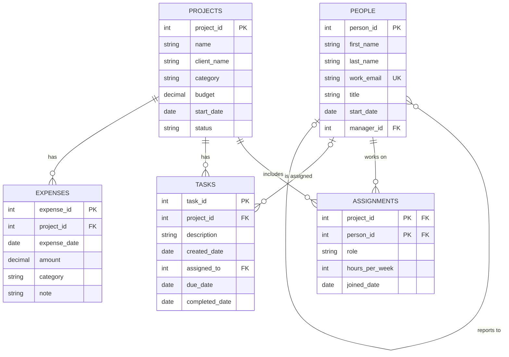

# BabsonAI Labs Database

## 1. The Scenario

**A. BabsonAI Labs.** A 25-person startup that builds AI tools for small businesses. It tracks who works on what, where the money goes, and who is overloaded: its people and who they report to, its projects and their budgets, who works on which project and how many hours a week, the tasks on each project and who they are assigned to, and the expenses charged to each project.

## 2. The ERD

## 3. What One Row Means

- One row of `people` is one employee of BabsonAI Labs, including the two founders.
- One row of `projects` is one project the company is running, for a client or for itself.
- One row of `assignments` is one person's commitment to one project: their role on it, the hours a week they give it, and the date they joined.
- One row of `tasks` is one piece of work on one project, assigned to at most one person.
- One row of `expenses` is one cost charged to one project.

## 4. Design Choices

**The key.** This seems like a natural key for work_email, like an order number or ticker. However, the scenario states that it will change when someone changes their title. Primary keys should never be changed so I have used a surrogate key (person_id) for people. But work_email is still marked as UNIQUE to ensure no two people have the same.

**Optional relationships.** people.manager_id is nullable due to "the two founders report to nobody," projects.client_name is nullable due to "internal projects have none," tasks.assigned_to is nullable due to "a new task may be unassigned," and tasks.completed_date is nullable due to "stays empty until it is" completed.

**The rule the tables cannot hold.** A task is assigned only to somebody who works on its project" requires three tables (tasks, assignments, people). As CHECK constraints can only apply to one row in one table, this is not something that can be enforced by the database. Instead the constraint was checked using the query in question 7 of build.py. This joins tasks to assignments and ensures there are no tasks assigned that aren’t assigned to someone on the teams for that project.

**Working with the agent.**  I worked with my agent. I told them the scenario and asked them to design the ERD and CREATE TABLES. They noticed that one of the constraints from the scenario wasn’t being enforced in make_data.py. The constraint was that a task couldn’t be created until the person it is assigned to has begun. They fixed the data generator so that this can’t happen. I also checked that the optional relationships were correct in the data. Ensuring the relationship was there due to a specific sentence in the scenario.